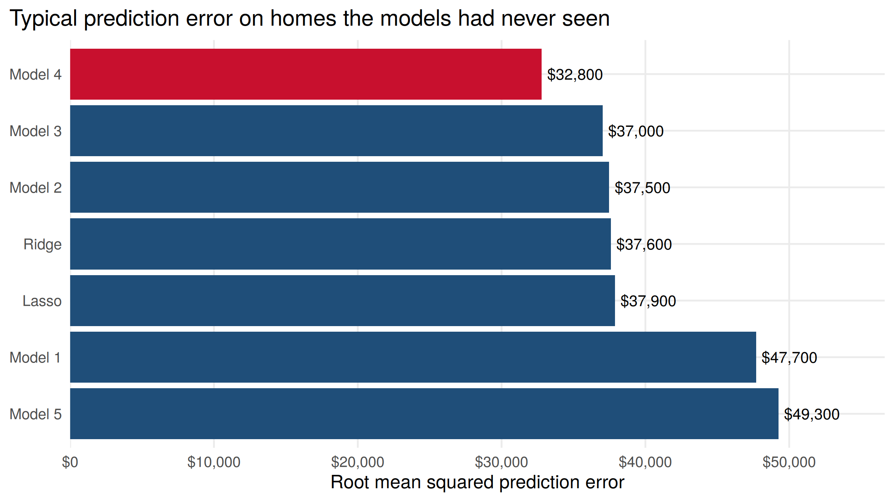
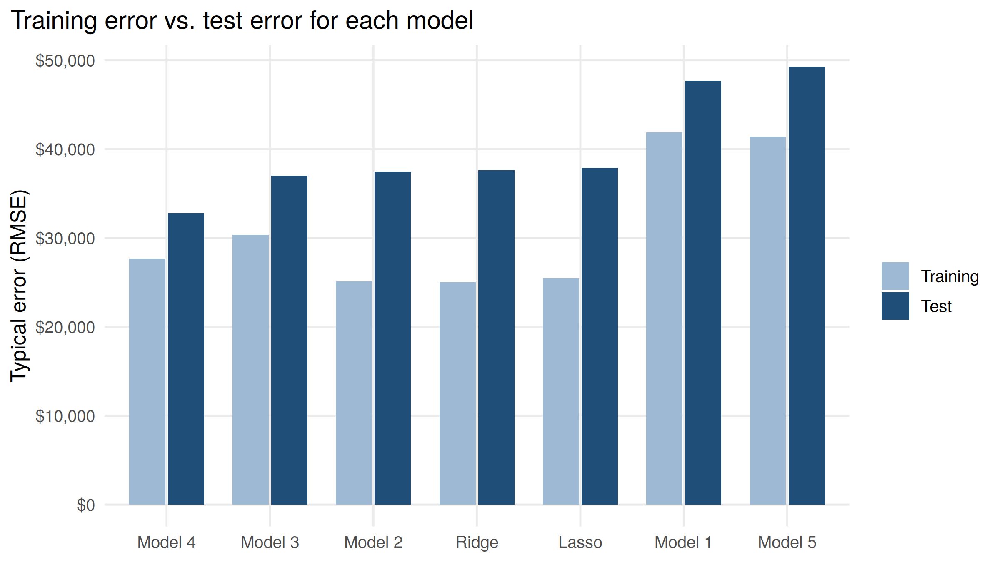

# Predicting Home Prices in Ames, Iowa

Does the model that fits the data best also make the best predictions? I built five regression models to predict home sale prices in Ames, Iowa, ranked them by in-sample fit, and then tested how well each one predicts prices for homes it has never seen. I also compared them to lasso and ridge regression.

## Key findings

- **The best fit wasn't the best predictor.** The kitchen sink model (nearly every variable, 110 coefficients) had the highest R², adjusted R², and the lowest AIC. On new homes it was beaten by a smaller model.
- **Model 4 had the lowest prediction error**, with a typical error of about $32,800 on test homes, roughly $4,200 better than the next model. It was the model I picked as the likely winner before seeing any results. BIC, which penalizes extra variables more heavily, was the only in-sample measure that agreed.
- **Overfitting explains the gap.** The kitchen sink model's error grew by $12,400 going from training to test homes, compared to $5,100 for Model 4.
- **The metric matters.** Lasso and ridge were slightly better on average percent error (about 10.8% to 10.9% vs. 11.5% for Model 4). Model 4's edge on dollar error comes from avoiding a few large misses.
- **Every model underprices the most expensive homes.** Only 21 training homes sold for more than $400,000, so there's little to learn from at the top of the market.

| Model | Strategy | Test RMSPE | Test MAPE |
|---|---|---|---|
| Model 4 | Size, location, quality, and rooms, with curved living area | $32,782 | 11.5% |
| Model 3 | Categorical and count variables with interactions | $37,019 | 13.2% |
| Model 2 | Kitchen sink, nearly every variable | $37,475 | 11.3% |
| Ridge | All variables, coefficients shrunk | $37,590 | 10.9% |
| Lasso | All variables, kept 83 of 134 | $37,878 | 10.8% |
| Model 1 | A handful of sale, building, and lot features | $47,691 | 17.2% |
| Model 5 | Size only | $49,253 | 18.4% |

*RMSPE is the typical prediction error in dollars. MAPE is the average error as a percent of the sale price.*

## Data

The [Ames Housing dataset](https://www.kaggle.com/c/house-prices-advanced-regression-techniques), a public dataset of residential home sales in Ames, Iowa. It's split into 1,000 training homes, used to fit the models, and 460 test homes, used only to check predictions. Each home has 60 features covering the lot, neighborhood, size, quality, age, rooms, basement, and garage.

## Methods

1. Built five OLS models with different variable selection strategies, from a small hand-picked set to nearly every variable.
2. Compared them on in-sample fit: R², adjusted R², AIC, BIC, and training RMSE.
3. Fit lasso and ridge regressions on the full variable set, with the penalty chosen by 10-fold cross-validation.
4. Predicted prices for the test homes and compared every model on RMSPE and MAPE.
5. Compared training and test error for each model to measure overfitting.

## Tools

R (tidyverse, glmnet, scales, knitr), R Markdown

## Files

| File | What it is |
|---|---|
| `house_prices.Rmd` | Full analysis and write-up |
| `house_prices.html` | Knitted report, open in a browser |
| `data/house_price_train.csv` | Training homes |
| `data/house_price_test.csv` | Test homes |
| `images/` | Charts used in this README |

## How to run it

1. Clone this repo and open `house_prices.Rproj` in RStudio.
2. Install the packages: `install.packages(c("tidyverse", "here", "glmnet", "scales"))`
3. Knit `house_prices.Rmd`.

## Limitations

The test set has only 460 homes, so close rankings could change with a different split, and cross-validating across many splits would give a more reliable comparison. RMSPE is sensitive to a few large misses, which is why I report MAPE alongside it. The data also covers one city, so these models wouldn't necessarily carry over to other housing markets.

## Background

This started as my final project for Econ 4750 at the University of Georgia in Fall 2024. When I came back to it, I found that the squared and cubed terms in my original formulas were written as `I(LotArea)^2`, which R doesn't treat as squaring, so two of the models were missing their curved terms. Fixing that moved Model 4 from fourth place to first. I also added lasso and ridge on the full variable set and the comparison of training and test error.

---

**David Barrero** · [LinkedIn](https://www.linkedin.com/in/david-barrero1) · [GitHub](https://github.com/david-barrero)
